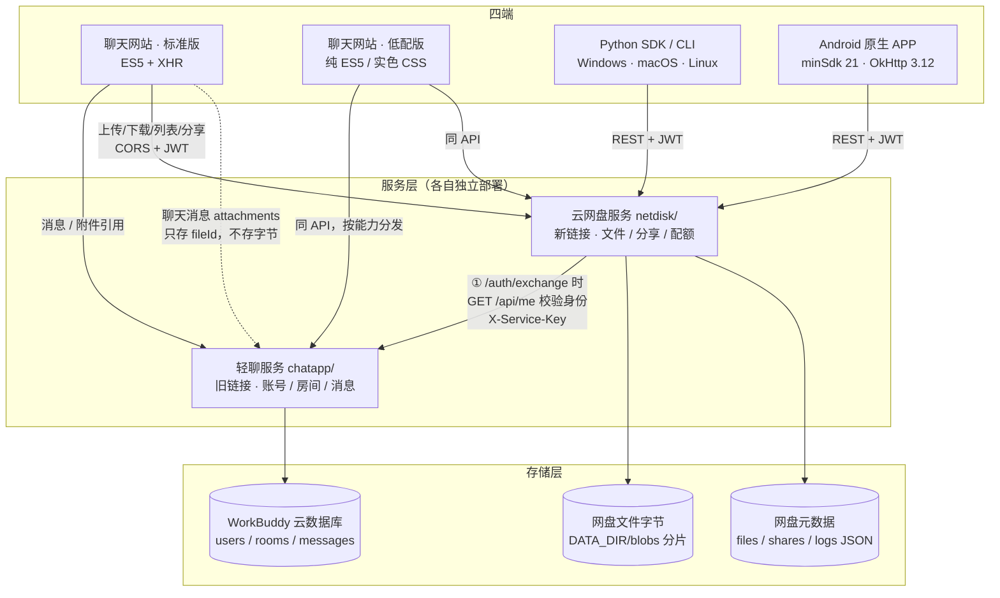
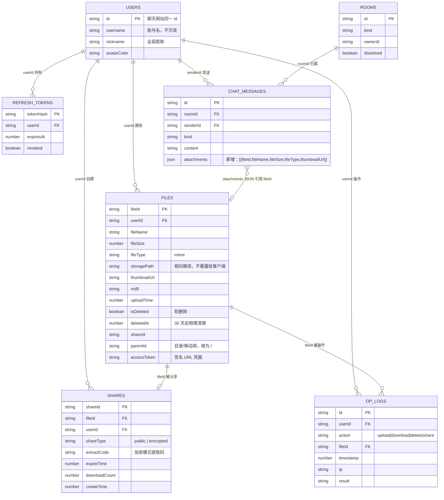

# 云网盘 + 聊天网站集成 + 编程调用层 + Android APP · 技术方案

> 版本：v1.0（方案与契约先行版）
> 日期：2026-11-13
> 适用聊天网站：当前工作区 `chatapp/`（轻聊，已上线 `qingliao-chat-33476.app.workbuddy.host`）
> 网盘项目根目录：`netdisk/`（**独立目录 → 独立发布 → 独立新链接**）

---

## 0. 三个前置结论（先看这个）

### 0.1 新链接发布可行，且是推荐做法

平台按「**项目目录**」判定应用：一个没有发布记录的目录，首次发布会自动创建全新应用与全新链接。
因此把网盘放在 `netdisk/` 独立目录，发布后得到的是**第二条链接**，现有聊天网站的链接、数据、发布记录都不受影响。

| 项目 | 目录 | 链接 | 说明 |
|---|---|---|---|
| 轻聊（现有） | `chatapp/` | `qingliao-chat-33476.app.workbuddy.host` | 保持不变，仅前端做迭代更新 |
| 云网盘（新增） | `netdisk/` | 发布后由平台分配（建议域名前缀 `qingliao-netdisk`） | 独立服务、独立进程、独立端口 |

> 注意：聊天网站**前端**因为要加「我的网盘 / 消息附件 / 共享文件」入口，仍需做一次**迭代更新**并重新发布到原链接。
> 这是内容更新，不是「被网盘替换」——原链接、原账号、原消息、原文件全部保留。若你希望连聊天网站前端都先不动，
> 可以把模块二整体延后，先只交付独立网盘 + 新链接 + SDK/CLI。

### 0.2 账号打通不走共享数据库，改走「服务间 Token 校验」

**风险**：现有 `chatapp/src/cloud.js` 把 `endpoint` 固定为
`https://qingliao-chat-33476.app.workbuddy.host`，且 `originFetch(origin)` 用应用发布域名作为
`Origin` 请求头。云数据库按 Origin 白名单校验，新域名直接读同一个库很可能被拒。

**解法**（聊天网站服务端零改动）：

```
聊天网站前端              网盘服务                     聊天网站服务端
    │  ① 带上聊天网站 session token
    │  POST /auth/exchange  ─────►│
    │                            │ ② GET /api/me（服务端到服务端）
    │                            │ ───────────────────────────►│
    │                            │ ◄────── { user: {...} } ─────│
    │  ③ 校验通过 → 签发网盘 JWT（Access 2h / Refresh 7d）
    │  ◄────────────────────────│
```

- 网盘服务**不直接访问聊天网站的数据库**，只通过已有的 HTTP API 校验身份，符合「四端都走 API」的规范。
- 网盘侧用自己的 `JWT_SECRET`（HS256，Node 内置 `crypto` 实现，零第三方依赖）签发 Token。
- 服务间调用带 `X-Service-Key` 共享密钥，避免被当成普通用户请求滥用。
- 好处：账号仍是同一套（`users` 表唯一），但两个服务可独立部署、独立扩容、独立换域名。

### 0.3 Android 改为现代化原生应用（不再是 WebView 壳）

现有 `chatapp/android/` 是 `minSdk 19` 的纯 WebView 映射壳（`api19-Browser.apk`）。按你的要求，
网盘 APP **不复用这个形态**，改为原生实现：XML 布局 + RecyclerView + Material 风格 +
OkHttp 3.12.x + Glide + 前台 Service 队列，`minSdk 21 / targetSdk 34`，不用 Compose、不用 WebView 承载业务。

---

## 1. 技术栈选型与理由

| 模块 | 选型 | 选型理由 / 兼容性考量 |
|---|---|---|
| 网盘后端 | **Node.js 22 + 原生 `http`，零 Web 框架** | 与现有 chatapp 同栈、单端口、易部署；上传下载全程**流式 IO**，不把文件读进内存，低配机器/小内存沙箱也稳；无框架=无依赖膨胀与老版本 CVE |
| 文件字节存储 | 本地分片目录（`DATA_DIR/blobs`），抽象成 `BlobStore` 接口，可切对象存储 | 发布沙箱不提供数据库；抽象层保证以后换 S3/COS 只改一个适配器。与 chatapp 的 `blobstore.js` 设计一致 |
| 元数据 | JSON 文档集合（`users / files / shares / logs / refreshTokens`），带原子写 | 与 chatapp 的 `store.js` 一致；零运维。生产可切 WorkBuddy 云数据库或 SQLite |
| 认证 | **JWT HS256，Node 内置 `crypto` 手写** + Access 2h / Refresh 7d | 满足规范；不引 `jsonwebtoken`，减少依赖；Token 无状态，便于多实例 |
| 限流 | 进程内滑动窗口（单用户 60 次/分） | 零依赖；多实例时换 Redis 即可，接口不变 |
| 聊天网站前端 | **原生 ES5 + XHR**，新增 `netdisk.js` / `netdisk-lite.js` | 现有 `app.js` 已是纯 ES5（`utf8Bytes` + XHR），**源码本身合规，不需要 Babel**；沿用现有的「标准版 / 低配版按能力分发」架构，新功能两版都做 |
| 前端 CSS | Flexbox 为主 + float 降级；**零 CSS 变量、零 Grid、零 aspect-ratio** | 覆盖 Chrome 49+ / Safari 9+ / Firefox 52+；低配版继续用实色 CSS（现有 `style-lite.css` 已验证零变量） |
| 图片懒加载 | `scroll` 事件 + 节流（不用 IntersectionObserver polyfill） | 老浏览器最稳，少一个 polyfill 包 |
| PDF 预览 | **不内嵌 pdf.js**，改为「服务端生成首页缩略图 + 新窗口下载/系统打开」 | pdf.js 老浏览器兼容版本体积大、worker 在 Safari 9 / Android 5 WebView 易失败；轻量卡片更稳，低配设备不 OOM |
| Python SDK | Python 3.6+ / `requests` / 标准库 `typing` | 满足规范；`tqdm` 仅可选依赖，缺失时自动降级为自实现进度条 |
| CLI | 标准库 `argparse` + SDK | 跨平台零额外依赖；`--json` 输出便于管道 |
| Android | Java 8（desugar）+ AndroidX + XML + RecyclerView + **OkHttp 3.12.x** + Glide 4.x + 前台 Service | OkHttp 3.12 是最后支持 Android 5 的稳定分支；Glide 兼容 API 14+；**不用 Compose**（低配设备性能差）、不用 Coil、不用高版本 DataBinding 特性；启用 multidex（Android 5.x 需 `MultiDexApplication`） |
| API 文档 | OpenAPI 3.0（`docs/openapi.yaml`） | 四端共用同一份契约 |

> 为什么后端不选 Python/Go：现有聊天网站是 Node，同栈能让「服务间校验 / 分片协议 / 部署脚本」直接复用，
> 且本次四端契约里已有大量 Node 侧既有约定（分片 `chunk?i=`、签名 URL `?k=`、统一 `{ok,...}` 响应），
> 统一到 Node 成本最低。Go 在高并发上更优，但会引入第二套构建链，对当前项目规模收益不明显。

---

## 2. 系统架构图（Mermaid）



**数据流要点**
1. 文件字节**只进网盘服务**；聊天消息只存 `attachments: [{fileId, ...}]` 引用，避免两处存副本。
2. 账号唯一真源仍是聊天网站 `users` 表；网盘只保存 `userId` 与展示快照（`username/nickname`）。
3. 下载统一走**签名 URL（15 分钟）**，聊天网站/Android 拿到的是 URL，不接触存储路径。
4. 两服务之间只有一处耦合：`/auth/exchange` 的服务间校验，且是单向调用。

---

## 3. 数据库 ER 图（Mermaid）



> 说明：`USERS / ROOMS / CHAT_MESSAGES` 是**已有表**（在聊天网站侧），网盘侧不做副本，
> 只通过 `/auth/exchange` 读取身份。`FILES / SHARES / OP_LOGS / REFRESH_TOKENS` 是网盘新增表。
> 因此 ER 图表达的是逻辑关联，物理上跨服务，用 `userId` / `fileId` 做外键语义。

---

## 4. 统一契约

### 响应格式

```json
{ "code": 0, "message": "ok", "data": { } }
```

### 错误码

| code | 含义 | HTTP 建议 |
|---|---|---|
| 0 | 成功 | 200 |
| 40001 | 认证失败 / Token 过期 / 刷新无效 | 401 |
| 40002 | 文件过大 | 413 |
| 40003 | 文件类型不允许 | 415 |
| 40004 | 存储空间不足 | 409 |
| 40005 | 分享已过期 / 提取码错误 | 410 |
| 40006 | 文件不存在 | 404 |
| 40007 | 限流（每分钟 60 次） | 429 |
| 50000 | 服务器内部错误 | 500 |

完整接口定义、请求/响应示例见 **`docs/openapi.yaml`**（OpenAPI 3.0）。

### 核心设计约定

- **分片**：`POST /files/chunk/init` → `PUT /files/chunk/{uploadId}/{index}`（每片 5MB，移动网络 2MB）→ `POST /files/chunk/complete`。
  `GET /files/chunk/{uploadId}` 返回已收分片索引，实现断点续传；SDK 侧另存 `.resume` 进度文件。
- **下载**：`GET /files/{fileId}/download` 支持 `Range: bytes=start-end`，返回 `206` + `Content-Range`；
  同时提供 `GET /files/{fileId}/signed-url` 生成 15 分钟签名 URL 防盗链，并校验 `Referer` 白名单。
- **软删除**：`deleted=true` + `deletedAt`，后台任务扫描超过 30 天的记录做物理清理（字节 + 元数据）。
- **限流**：按 `userId` 滑动窗口 60 次/分，超限返回 40007 + `Retry-After`。
- **日志**：所有 upload / download / delete / share 写 `opLogs`，字段 `userId, action, fileId, timestamp, ip, result`。
- **性能监控**：记录每个关键接口 `响应时间 / 状态码`，聚合到 `GET /metrics`（仅服务密钥可见）。

---

## 5. 聊天网站集成要点（模块二，兼容性处理）

| 功能 | 落点 | 兼容性处理 |
|---|---|---|
| 消息附件 `attachments` | `chat_messages` 扩展 JSON 数组；`decorateMessage()` 下发 | 老消息无该字段时前端判空，不做 `Array.isArray` 之外的现代 API |
| 从网盘选文件 / 新上传发送 | 聊天页新增「网盘」按钮，弹层用现有 `openModal` | 标准版 ES5 DOM 构建；低配版 `innerHTML` + `eachAttr` 绑定，均不用 `dataset`/`classList` |
| 图片/视频/音频内嵌预览 | `` / `<video>` / `<audio>` 原生标签 | 老浏览器原生标签最稳；不引任何播放器库 |
| PDF/文档 | 缩略图 + 下载卡片（不内嵌 pdf.js） | 见 §1 选型理由 |
| 其他文件 | 下载卡片（图标 + 名 + 大小 + 按钮） | 纯 HTML + Flexbox，无 CSS 变量 |
| 分享卡片 | 消息文本识别分享链接 → 解析为卡片 | 正则 + XHR，无 Fetch / 无 URLSearchParams（老 Safari 9 不支持） |
| 「我的网盘」入口 | 用户中心新增卡片 | 用量进度条用 `display:flex` + `width:%`，float 降级 |
| 「共享文件」标签页 | 群聊/私聊设置面板 | 按 `attachments` 聚合，时间倒序、类型筛选 |
| 图片懒加载 | `scroll` 事件 + 节流 | 不依赖 IntersectionObserver |
| 文件传输 | 全部 HTTP XHR | 不用 WebSocket 传文件 |

> 现有 `chatapp` 的 `app.js` 已是 ES5，`style.css` 用了 CSS 变量（标准版），但**低配版 `style-lite.css` 已验证零变量零 flex**。
> 新增模块会同时提供标准版脚本与低配版脚本，继续走服务器按能力分发的既有机制。

---

## 6. 编程调用层要点（模块三）

- 包结构按规范：`client.py / auth.py / upload.py / download.py / models.py / exceptions.py / utils.py / config.py`。
- `NetDiskClient` 统一持有 `requests.Session`，请求前检查 Access Token 过期（留 60s 缓冲）自动用 Refresh 换新。
- 断点续传：上传用 `uploadId + .resume` 文件记录已完成分片；下载用 `Range` + 本地 `.part` 文件。
- 进度回调统一 `on_progress(uploaded_bytes, total_bytes)`；CLI 用自实现文本进度条（无 tqdm 也能跑）。
- 类型提示用 `typing.Optional/List/Dict`（Python 3.6 兼容），不用 `from __future__ import annotations`、不用 `|` 联合类型。
- 异常映射：`40001 → AuthError`、`40002 → FileTooLargeError` …… 全部带错误码与解决建议。

---

## 7. Android APP 要点（模块四，现代化原生）

| 项 | 做法 |
|---|---|
| 形态 | **原生**，非 WebView 壳；登录 / 列表 / 详情 / 传输队列 / 设置 全为 Activity + Fragment |
| 版本 | `minSdkVersion 21`、`targetSdkVersion 34`、`compileSdk 34` |
| 语言 | Java 8 + desugar，`sourceCompatibility/targetCompatibility = VERSION_1_8` |
| 网络 | OkHttp 3.12.13（最后支持 Android 5），连接 15s / 读取 60s |
| 图片 | Glide 4.x + 强制 `inSampleSize` downsampling；`LruCache` 上限 = 可用内存 1/8 |
| 列表 | RecyclerView + ViewHolder，`setItemViewCacheSize` + `RecycledViewPool`，分页加载 |
| 传输 | 前台 Service + Notification（Android 5 用 `NotificationCompat`，不用渠道概念）+ 队列暂停/继续/取消 |
| 多选 | `ActionMode` + `SparseBooleanArray`，长按进入 |
| 下载 | `Range` 断点，完成后 `MediaScannerConnection.scanFile` |
| 权限 | Android 5 install-time；6+ 运行时 `REQUEST_EXTERNAL_STORAGE`；10+ 用分区存储降级到 app 私有目录 |
| multidex | `multiDexEnabled true` + `MultiDexApplication`（Android 5.x 必须） |
| 体积 | `minifyEnabled true` + `shrinkResources true` + R8 |
| 低配优化 | 移动网络分片降到 2MB；所有 IO 在子线程；禁止主线程读大文件；避免一次性加载整张位图 |

---

## 8. 兼容性专项清单

### 浏览器（Chrome 49+ / Safari 9+ / Firefox 52+）

- [x] 源码 ES5，不使用箭头函数 / 模板字符串 / `let` / `const` / `async` / `Promise` / `fetch`
- [x] 不使用 `URLSearchParams` / `Object.assign` / `Array.includes` / `String.padStart`（均需 polyfill）
- [x] XHR 显式发 UTF-8 字节（沿用现有 `utf8Bytes`）
- [x] CSS 不用 `var()` / Grid / `aspect-ratio` / `calc()` 复杂表达式；Flexbox 带 float 降级
- [x] 视频音频用原生标签；PDF 走缩略图 + 下载，不引 pdf.js
- [x] 分享链接解析用正则，不用 `new URL().searchParams`
- [x] 懒加载用 scroll + 节流
- [x] 文件操作全 HTTP，不碰 WebSocket
- [x] 低配版（Android 5.x WebView）继续用实色 CSS + cookie 兜底 token

### Android 5.0 / 5.0.1 / 5.0.2 / 5.1

- [x] `minSdk 21`，所有依赖 minSdk ≤ 21（重点核对 OkHttp / Glide / AndroidX 各库）
- [x] 不用 Compose、不用 Coil、不用 `java.time`（需 desugar）、不用 Java 9+ API
- [x] `MultiDex.install()` 在 `attachBaseContext` 调用
- [x] Notification 用 `NotificationCompat`，不调用 API 26+ 渠道 API（做版本分支）
- [x] 前台 Service 用 `startForeground`，Android 8+ 再补渠道（版本判断）
- [x] 文件 URI 用 `FileProvider`，不用 `file://`（7.0+ 会抛 FileUriExposedException）
- [x] 大图 downsampling，禁止 `BitmapFactory.decodeFile` 直接解码原图
- [x] 网络/文件 IO 全在子线程，避免 ANR
- [ ] **真机验证**：红米 Note 2 级设备冷启动、列表滑动、上传大文件、后台传输（需你手上有设备时确认）

---

## 9. 分步实施计划（按优先级）

| 里程碑 | 内容 | 产出 | 预计工时 |
|---|---|---|---|
| **M0 · 契约与发布验证**（本批） | 技术方案、OpenAPI 3.0、独立目录、新链接发布可行性验证 | `docs/技术方案.md`、`docs/openapi.yaml` | 2h |
| **M1 · 网盘后端** | 独立 Node 服务：JWT/刷新、普通+分片上传与断点、Range 下载、列表/详情/删除/移动重命名/分享/配额、限流、签名 URL、操作日志 | `netdisk/` 可运行服务 + 新链接 | 8h |
| **M2 · 编程调用层** | Python SDK 8 模块 + CLI 全部命令 + `--json` / 进度条 / Token 本地存储 | `netdisk-sdk/` + `netdisk` 可执行 | 6h |
| **M3 · 聊天网站集成** | 标准版 + 低配版：消息附件、预览卡片、分享卡片、我的网盘、共享文件；`/auth/exchange` 前端接线；旧链接迭代发布 | chatapp 更新 + 回归全绿 | 8h |
| **M4 · Android 原生 APP** | 登录、文件列表、上传/下载 Service、队列、多选操作、预览、存储用量、权限；minSdk21 全套优化 | 可构建 APK 工程 | 14h |
| **M5 · 联调与验收** | 四端打通、OpenAPI 契约测试、老浏览器矩阵、Android 5.0.2 真机、性能与 OOM 检查 | 验收报告 | 6h |

**合计约 44h**，建议按 M0→M1→M2→M3→M4→M5 顺序推进；M1 完成后即可拿到新链接并独立试用，
后续里程碑不影响已有链接。

### 风险登记

| 风险 | 影响 | 缓解 |
|---|---|---|
| 新域名云数据库 Origin 白名单 | 账号打通失败 | 已设计为服务间 `/api/me` 校验，不直连库（§0.2） |
| 发布沙箱不提供数据库，重启丢数据 | 文件字节/元数据不持久 | `BlobStore` 抽象 + 可配置 `DATA_DIR`；生产切对象存储 / 云数据库 |
| 跨服务 CORS | 聊天网站调网盘被拦 | 网盘返回 `Access-Control-Allow-Origin` 白名单 + `OPTIONS` 预检 |
| 聊天网站前端更新会重发旧链接 | 用户担心「被替换」 | 只是内容迭代，链接与数据不变；也可按 §0.1 延后 M3 |
| Android 5.0.2 真机不可得 | 无法实测 OOM/ANR | 提供低配模拟器配置 + 内存/线程静态检查清单，真机项留给你确认 |

---

## 10. 本批交付物

- `docs/技术方案.md`（本文件）
- `docs/openapi.yaml`（OpenAPI 3.0 完整接口契约）
- `netdisk/` 独立目录已创建（尚未写入服务代码，待确认后进入 M1）

> 代码规范：中文注释；函数/变量驼峰法；常量全大写下划线。
